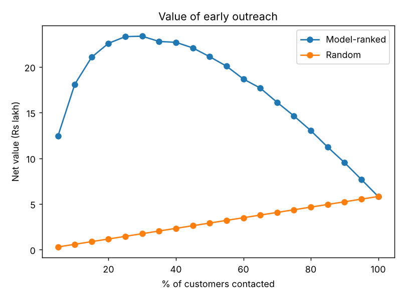

# Bank Risk Analytics: 4 end-to-end ML projects in one repo

Credit-card delinquency, loan scoring with a fairness audit, fraud detection, and churn with a retention strategy.
Each project is framed as a **business decision** (who to call, who to approve, which transactions to block,
who to save) and reports **rupee impact**, not just accuracy.

```bash
pip install -r requirements.txt
python run_all.py            # ~10 s: generates data, trains all models, writes outputs/ and models/
streamlit run app.py         # optional live demo
python -m pytest -q          # tests
```

> **About the data:** the repo generates **synthetic** bank data (`src/data.py`) so it runs offline and is fully
> reproducible. It has realistic structure: class imbalance, missing values, hidden risk factors, and a
> gender-income proxy for the fairness audit. Because it is synthetic, absolute numbers are illustrative.
> To use real data, pass your own files: `python run_all.py --customers-csv my.csv --transactions-csv tx.csv`
> (same column names as `data/customers.csv` / `data/transactions.csv`).

## Results (25,000 customers, 120,000 transactions, held-out test sets)

| # | Project | Key result |
|---|---------|-----------|
| 1 | **Card delinquency** | ROC-AUC **0.83**, KS 0.50, top-decile lift **4.2x**. Probabilities calibrated (predicted 12.0% vs actual 11.8%). Contacting only customers with positive expected value (27% of the book) gives **Rs 25.6 lakh** net vs **Rs 1.6 lakh** for random outreach of the same size. |
| 2 | **Loan scoring + fairness** | WOE scorecard Gini **0.46** vs gradient boosting 0.47 (almost no accuracy lost for a fully transparent model). Approving the best 70% cuts the bad rate **14.0% to 8.4%**. Fairness audit: disparate-impact ratio 0.99 (gender) and 0.91 (age), above the 0.80 four-fifths threshold. |
| 3 | **Fraud detection** | 0.6% fraud rate. Best supervised PR-AUC **0.24** vs unsupervised Isolation Forest 0.09 (a "never fraud" model has 99.4% accuracy and catches nothing). Cost-based threshold on a time-ordered test set: **62% lower fraud cost** (Rs 8.9 lakh to 3.4 lakh) at 63% recall. |
| 4 | **Churn + retention** | ROC-AUC **0.80**, top-decile lift 3.3x. Targeting the 19% of customers with positive expected value earns **Rs 18.2 lakh**; random outreach of the same size loses Rs 7.6 lakh and offering everyone loses Rs 40.6 lakh. |

Figures are in `outputs/figures/`, tables in `outputs/`, all metrics in `outputs/metrics.json`.



## What each project demonstrates

### 1. Credit-card delinquency (`src/delinquency.py`)
- Feature engineering (unpaid share, utilisation x unpaid, limit-to-income...), median imputation + missing-flags.
- **Class imbalance:** class-weighting compared with no weighting. Recall at the 0.5 threshold goes from 25% to 71% with weighting.
- **Calibration** (sigmoid, on held-out data) so predictions can be compared with rupee costs.
- **Business framing:** contact a customer only if `P(default) x balance x save-rate > contact cost`.
- **Explainability:** permutation importance, per-customer "top reasons" (occlusion method), and an optional SHAP summary plot (runs automatically if `shap` is installed).
- Output: `outputs/delinquency_priority_contact_list.csv` (who to call first, and why).

### 2. Loan approval scorecard + fairness (`src/credit_scoring.py`)
- Hand-built **Weight-of-Evidence encoder, Information Value, and points-based scorecard** (600 points = 50:1 odds, +20 points doubles the odds), the format banks and regulators use. See `outputs/scorecard_points.csv`.
- Compared with plain logistic regression and gradient boosting.
- **Fairness audit** on gender and age group: approval rate, bad rate of approved, approval rate of good applicants, disparate-impact ratio. Protected attributes are **excluded from the models but audited**, which catches proxy effects.

### 3. Fraud detection (`src/fraud.py`)
- Extreme imbalance (0.6%), so models are judged on **PR-AUC and precision/recall**, not accuracy.
- **Time-ordered** train / validation / test split (no future leakage).
- Unsupervised (Isolation Forest) vs supervised models.
- Alert threshold chosen by **minimising cost** (missed fraud amount + Rs 120 per review) on validation only, then evaluated on untouched test data.

### 4. Churn + retention (`src/churn.py`)
- Calibrated churn probabilities, then **expected-value targeting**: `P(churn) x effectiveness x revenue x years - offer cost`.
- Rule-based **next-best-action** playbook (service recovery, re-engagement, salary-account offer, cross-sell...).
- Output: `outputs/churn_retention_targets.csv`.

## Honest notes
- On this synthetic data, logistic regression performs on par with or better than gradient boosting because the generator is close to linear. On real, messier data boosted trees usually pull ahead. The code makes that comparison easy to rerun.
- The business parameters (contact cost, save rate, offer cost, effectiveness) are **assumptions** at the top of each module. Change them and the strategy updates.
- The occlusion-based reasons are a lightweight stand-in for SHAP; install `shap` to also get a SHAP summary plot.

## Project structure
```
run_all.py            one command to run everything
app.py                Streamlit demo (4 tabs)
src/data.py           synthetic data generators
src/delinquency.py    project 1
src/credit_scoring.py project 2 (WOE scorecard + fairness)
src/fraud.py          project 3
src/churn.py          project 4
src/predict.py        inference layer used by the app
tests/                sanity tests (directionality, calibration, no protected attributes, value > random)
outputs/              figures, CSV tables, metrics.json
```

## Ideas to extend
Replace synthetic data with real datasets (e.g. UCI "Default of Credit Card Clients", the ULB credit-card fraud dataset), add MLflow tracking, Dockerise the app, add drift monitoring (PSI) on the scorecard.
